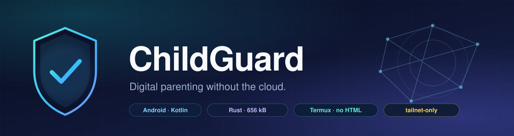

<div align="center">
  
  <br><br>
  <strong>Digital parenting without the cloud.</strong><br>
  A Kotlin Android app, a single-binary Rust collector, and a terminal dashboard —<br>
  running on hardware and a network you control.
  <br><br>
  
  
  
  
  <!-- Local SVG assets only: no external badge services. Keep tests.svg in sync. -->
  <br><br>
  <a href="#why-childguard">Why</a> ·
  <a href="#features">Features</a> ·
  <a href="#architecture">Architecture</a> ·
  <a href="#quick-start">Quick start</a> ·
  <a href="#verification">Verification</a> ·
  <a href="#security-model">Security</a> ·
  <a href="#documentation">Docs</a>
</div>

<br>

> [!NOTE]
> **Status:** Feature 1 — accessibility capture — is verified end to end:
> real Android runtime events → bounded upload → Rust collector → Termux
> dashboard. The full suite is **71 tests, 0 failures, 0 skipped** against a
> live collector, plus 40 collector tests and 21 dashboard regression tests.
> Remaining work is a run on a physical phone; no Android device or KVM is
> available in the build environment.

## Why ChildGuard

| Principle | What that means |
|---|---|
| **Private by construction** | No account, no cloud, no telemetry. The app speaks HTTP to a collector you run, over a Tailscale/WireGuard tailnet or a hotspot. The collector binds `127.0.0.1` unless you name an interface, needs a bearer token on every route, sends no CORS headers, and cannot execute commands. It writes `state.json` owner-only (`0600`) and never echoes the parent token. |
| **Honest about trade-offs** | [`AUDIT.md`](AUDIT.md) is a real audit: it found a reverse-shell prototype, token leaks, a collector crash, and a disk-bound write path. It also states the measured result that **Node serves more writes per second than this Rust server** — Rust is kept for memory and footprint, not hype. |
| **Built for a phone** | 681 kB collector binary, 768 kB idle RSS, 250-event upload batches with retry-first queues, and bounded view traversal so a huge chat or browser tree cannot turn the accessibility callback into an ANR. |
| **A dashboard, not a web page** | `termux/dashboard.py` is pure Python standard library and prints to the terminal. One command checks health + token before you trust a blank screen. |

## Features

| # | Feature | What actually ships | Status |
|---|---|---|---|
| **1** | Accessibility capture | Typed text, keystrokes, visible screen text, active app, scroll-loaded content; stranger-signal detection with alert dedupe; password/PIN fields excluded | ✅ **Verified end to end** (15 unit + 11 runtime + 4 E2E tests) |
| **3** | Notification listener | Chat notifications only, stranger classification, 30 s re-post dedupe, bounded queue, 500-char text cap, chat-only fallback | ✅ **Verified** (11 runtime tests) |
| **6** | Transport + dashboard | Bounded batches, retries for flaky mobile data, crash-safe service lifecycle, sync, logs, screen time, alerts, export, doctor | ✅ **Verified** (4 lifecycle + 6 transport tests) |
| **5** | Reverse session | Not shipped. A no-auth, no-TLS shell is a liability in a parenting app; the prototype lives in [`docs/prototype/`](docs/prototype/README.md) | ⛔ **Prototype only** |

## Architecture

```text
┌──────────────────────────────┐        ┌──────────────────────────┐        ┌───────────────────────────┐
│  Android app (Kotlin)        │        │  Collector (Rust)        │        │  Parent (Termux)          │
│                              │        │                          │        │                           │
│  AccessibilityService ──┐    │  HTTP  │  /api/events  ◀──────────┼────────┤  dashboard.py             │
│  NotificationListener ──┼──▶ │ ─────▶ │  /api/stats   ◀──────────┼────────┤    --sync                 │
│  MonitorService ────────┘    │ bearer │  /api/export             │        │    --overview / --alerts  │
│    · 15 s upload loop        │ token  │                          │        │    --logs / --doctor      │
│    · 250-event batches       │        │  state.json (0600)       │        │                           │
│    · retry queue (1000)      │        │  bounded, deduped        │        │  SQLite + terminal UI     │
└──────────────────────────────┘        └──────────────────────────┘        └───────────────────────────┘
                                              ▲
                                              │  optional: SSE /api/stream
```

The Android app never talks to a vendor. The collector has no UI and no web
dashboard; it exposes a small authenticated JSON API and persists to one
owner-only file. The dashboard pulls from it and keeps a local SQLite copy.

## Quick start

### 1 · Collector

```bash
cd server-rust
cargo build --release --offline
CHILDGUARD_TOKEN="$(head -c 32 /dev/urandom | base64)"   ./target/release/childguard-server
# listening on 127.0.0.1:38080 (loopback only); the token is never printed
```

**Phone safety defaults.** The collector holds a child's messages, so it must
not become a service on the Wi-Fi just because it was started:

| Default | What it means |
|---|---|
| `BIND=127.0.0.1` | Only processes on this phone can connect. Nothing on the LAN, no hotspot client, no browser. |
| auth required | Every `/api/*` route needs `Authorization: Bearer <token>`; only `/health` is open (it returns `ok` and an uptime, nothing else). |
| no CORS | No `Access-Control-*` headers, so a web page cannot read the API even if it guesses the port. `CHILDGUARD_CORS=1` opts in for a browser UI. |
| no shell | Neither collector can execute a command: they parse HTTP/JSON and write one state file. There is no remote-command endpoint in the APK either. |

**Exposing it to the child's phone.** Bind the one address that phone reaches —
never `0.0.0.0` on a network you do not control:

```bash
BIND=100.x.y.z  ./target/release/childguard-server   # Tailscale/tailnet IP only
BIND=192.168.43.1 ./target/release/childguard-server # hotspot gateway only
```

Then put that same URL in the app's Setup screen. With no `BIND`, the app and
the collector must be on the same phone and use `http://127.0.0.1:38080`.

The legacy Node collector (`server/index.js`) exposes the same API and the
same defaults (`-r` not needed; it is plain CommonJS):

```bash
cd server
CHILDGUARD_TOKEN="$(head -c 32 /dev/urandom | base64)" node index.js
# BIND=192.168.43.1 node index.js   # same opt-in as Rust
```

The Rust build is the deployment target: same behaviour, 681 kB binary,
constant-time auth, poison-safe locking, coalesced persistence.

### 2 · Android app

```bash
cd android
gradle :app:assembleDebug          # see android/BUILD.md for the toolchain
```

Install the APK, then grant, in order:

1. **Accessibility service** — Settings → Accessibility → ChildGuard.
2. **Notification access** — Settings → Notifications → Device & app notifications.
3. **Battery optimization exemption** — so the foreground service survives.

Configure the collector URL and parent token in the app's setup screen. The
monitor runs as a low-importance foreground service with
`foregroundServiceType="specialUse"` (required on Android 14/15).

If the collector **permanently rejects** a batch (`400`/`415`/`422`), the app
first splits it to isolate the bad event, then drops only that event. Whatever
was lost is surfaced, not swallowed: the dashboard shows a red line naming the
count and HTTP status, the ongoing notification says the same, and changing the
server URL or token in Setup clears the historical count. The same counter also
covers the 200-event local capture queues: when a burst or a long outage
evicts the oldest event, the line changes to "lost locally: the capture queue
was full", so the cap never hides evidence. While an upload or registration
failure is *current* (wrong token, dead tailnet, server down), an amber line
names the cause and clears itself on the next successful upload.

**Build facts:** `minSdk 26`, `targetSdk 35`, `compileSdk 35`, version `1.0.0`.
The app runs on Android 8+, is hardened for Android 14/15, and does not back up
its token (`allowBackup=false`).

### 3 · Parent dashboard

```bash
pkg install python
./termux/dashboard.sh --configure --server http://<tailscale-ip>:38080 --token '<token>'
./termux/dashboard.sh --doctor
./termux/dashboard.sh --sync --overview
```

`--doctor` separates the two failures that look identical in a blank
dashboard. Example output from a healthy collector:

```text
  Connection doctor
    server : http://100.x.y.z:38080
    token  : set (32 chars)
    health : OK (service=childguard)      ← reachability, no auth
    auth   : OK                           ← token accepted
    data   : 7 events, 1 alerts, 2 child(ren), 1 online
  doctor: healthy
```

Exit codes: `0` healthy, `2` unreachable, `3` bad token, `4` unexpected
response, `5` no token. Full dashboard docs: [`termux/README.md`](termux/README.md).

## What the parent sees

Real output from the verification run (ANSI stripped):

```text
  Totals
    events   : 7
    alerts   : 1
    last log : 2026-11-18 02:36:23

  By event type
    typing             4
    screen activity    2
    STRANGER ALERT     1

  Interception log
  ─────────────────────────────────────────────────────
  [2026-11-18 02:36:23] Whatsapp           typing
      retry me
  [2026-11-18 02:36:23] Chrome             screen activity
      org.chromium.chrome.browser.ChromeTabbedActivity
  [2026-11-18 02:36:22] Whatsapp           typing
      hi mom how was school
  [2026-11-18 02:36:22] Whatsapp           typing
      hey kid, meet up after school alone
  [2026-11-18 02:36:22] Whatsapp           STRANGER ALERT
      hey kid, meet up after school alone

  Alert stream
  ─────────────────────────────────────────────────────
  ● [2026-11-18 02:36:22] HIGH — stranger detected
      hey kid, meet up after school alone
```

## Verification

Everything below is reproducible with the commands shown; the raw evidence and
method are in [`AUDIT.md`](AUDIT.md) and [`RUNTIME_TEST.md`](RUNTIME_TEST.md).

| Layer | Command | Last result |
|---|---|---|
| Collector unit tests | `cargo test --offline` | **40 passed, 0 failed** |
| Dashboard tests | `python3 -m unittest termux/test_dashboard.py` | **21 passed, 0 failed** |
| Collector lints | `cargo clippy --offline -- -D warnings` | **exit 0** |
| Legacy collector | `node server/smoke_test.js` | **SMOKE OK** |
| Android suite | `gradle :app:testDebugUnitTest --offline` | **71 tests, 0 failures, 0 skipped** |
| Connection | `python3 termux/dashboard.py --doctor` | **exit 0**, live counts |
| Failure modes | wrong token / dead collector | **exit 3 / exit 2**, no crash |
| APK | `:app:assembleDebug` | 7,400,169 bytes, `sha256 5e8ce1c7…e9baa` |

The Android suite includes real `onAccessibilityEvent` and
`onNotificationPosted` calls under Robolectric API 34, plus four tests that
upload to a live collector and read the result back.

<details>
<summary><strong>How the event pipeline stays correct on bad mobile data</strong></summary>

- Events are queued in bounded in-memory queues (200 / 500 / 1000) and never
  written to a message archive on the phone.
- Every upload cycle takes at most **250 events**, retries first, and leaves
  the remainder queued for the next cycle — a slow link makes progress instead
  of re-sending one growing request.
- Transient failures (timeouts, 401/403/404, 429, 5xx) requeue with
  exponential backoff (30 s → 5 min); a healthy link returns to 15 s.
- A `400`/`422` batch is split in half until the poison event is isolated, and
  a `413` shrinks the batch instead of discarding evidence.
- The collector dedupes event IDs, so retries cannot inflate counts.
- Screen dumps are deduped by content and rate-limited to one per 800 ms per
  package; identical dumps are not uploaded again.
- View traversal is capped at 400 nodes and 60 siblings per level; every
  `child()` call is a binder round-trip.

</details>

## Security model

- **Token handling** — bearer auth with constant-time comparison; the collector
  never returns the token, never logs a user-supplied token, and warns on short
  secrets. `/health` is unauthenticated and contains no secret material.
- **Data minimization** — the notification listener reads **chat apps only**
  (banking, 2FA, games and system notifications are never inspected), repeated
  posts are collapsed for 30 s, and accessibility capture skips
  `isPassword` fields so PINs and credentials are never uploaded.
- **At rest** — collector state and its data directory are `0600`/`0700` and
  fsynced before rename; dashboard config, database, export tarballs, archive
  members, and temp export files are `0600`; Android backup is disabled
  (`allowBackup=false`, `dataExtractionRules` excludes all domains).
- **Bounded input** — 2 MiB request bodies, 64 KiB headers, capped events,
  alerts, children, and dedupe keys; future-dated device timestamps are clamped.
- **Cleartext is a known trade-off** — plain HTTP is used because the collector
  is reached by IP over a tailnet and Android cannot allow-list bare IPs in a
  network security config. Keep the collector tailnet-only; terminate TLS before
  exposing it anywhere else (tracked in `AUDIT.md` F-11).

## Repository map

```text
android/            Kotlin app: accessibility + notification services, uploader, UI
  app/src/main/     production sources and manifest
  app/src/test/     52 JVM/Robolectric tests
server-rust/        recommended collector: one binary, hardened, no web UI
server/             legacy Node collector with the same API
termux/             terminal dashboard + sync helper (Python standard library)
docs/banner.svg     local README artwork
docs/badges/        local status badges — no external badge services
docs/prototype/     retired Feature 5 / logging prototypes, not compiled
AUDIT.md            findings, fixes, and local Rust-vs-Node benchmarks
FEATURE1.md         what Feature 1 captures and how it is proven
RUNTIME_TEST.md     runtime proof and the on-device checklist
ARCHITECTURE.md     component and feature mapping
```

## Documentation

| Document | Read it for |
|---|---|
| [`AUDIT.md`](AUDIT.md) | Security findings, fixed bugs, benchmark methodology, provenance |
| [`FEATURE1.md`](FEATURE1.md) | Feature 1 event types, hardening, and tests |
| [`RUNTIME_TEST.md`](RUNTIME_TEST.md) | Robolectric/live-server proof and the physical-device checklist |
| [`ARCHITECTURE.md`](ARCHITECTURE.md) | How the components fit; which features ship |
| [`termux/README.md`](termux/README.md) | Dashboard usage, doctor, export, cleanup |
| [`android/BUILD.md`](android/BUILD.md) | Build toolchain notes |
| [`docs/prototype/README.md`](docs/prototype/README.md) | Why the reverse-shell and logging prototypes are not shipped |

## Roadmap

- [x] Feature 1 proven end to end (runtime → upload → dashboard)
- [x] Feature 3 notification precision + runtime tests
- [x] Connection doctor and failure-mode handling
- [x] Bounded traversal, dedupe, and retry-batched uploads
- [ ] **Run on a physical phone** — the only remaining verification gap
- [ ] Raise `minSdk` to 34 (Android 14) if older devices need not be supported
- [ ] Terminate TLS if the collector ever leaves the tailnet
- [ ] Resolve the `QUERY_ALL_PACKAGES` Play policy question or scope it with `<queries>`

<div align="center">
  <sub>Every performance number here was measured locally; every bug fix was reproduced before it was fixed.<br>
  No cloud account, no telemetry, no web dashboard.</sub>
</div>
